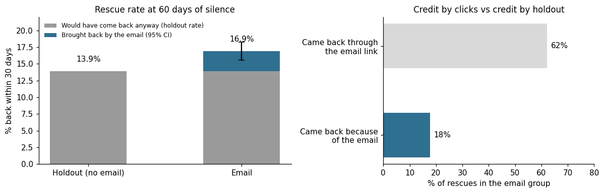
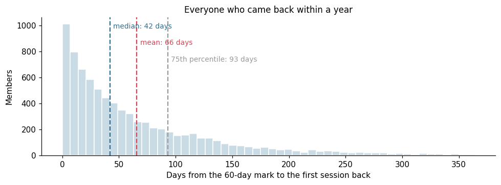
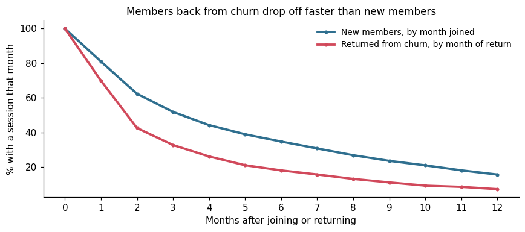
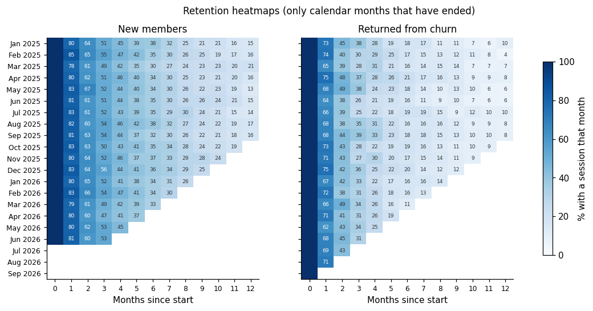

# Who comes back, and why? Churn, win-back and reactivation

A retention team sends a win-back email to members who go quiet for 60 days and reports that it "brings back" most of the members who return. This case study defines churn with window functions, measures the email against a random holdout, and checks how long returning members stay. Built as a dbt project on DuckDB, with data tests.

> **Everything in this repository is synthetic.** The app, the members, the sessions and every number are invented and generated by `data/generate.py`. The generator also records what each member would have done without the email, so the measured effect can be checked against the truth.



## The setting

A recipe and meal planning app with 20,000 members who joined between January 2023 and June 2026. Members use the app in spells: a few weeks of regular use, then a quiet period that ends with a return or never ends. Data runs to 2026-10-25.

| Definition | Rule | Where |
|---|---|---|
| Churned | 90 days without a session | `vars.churn_days` |
| Near churn | 60 to 89 days without a session | `vars.near_churn_days` |
| Reactivated | First session after being churned | `lifecycle_events` |
| Rescued | Back within 30 days of the 60-day mark | `vars.rescue_window_days` |

At 60 days of silence, every member is assigned at random: 90% get the win-back email, 10% are held out.

## 1. Churn and reactivation with window functions

`session_intervals` uses `LAG` to compute the days since each member's previous session. A gap of 90 days or more produces two events: a churn on the 90th day and a reactivation on the day of the return. A gap that is still open at the end of the data counts as a churn once it reaches 90 days. A data test checks that, for every member, churns and reactivations alternate.

On 2026-10-25: 2,307 members are active, 572 are near churn and 17,121 have churned.

## 2. The win-back email: credit vs causation

**The report said:** 62% of rescued members in the email group came back through the email link. The email works.

**The trap:** a member who was about to come back anyway also sees the email, and clicking it is the easiest way in. The click tells you which door they used, not why they came.

| Group | Assigned | Back within 30 days |
|---|---|---|
| Holdout (no email) | 2,923 | 13.9% |
| Email | 25,556 | 16.9% |
| **Difference** | | **+3.0 pp** (95% CI +1.7 to +4.3) |

The true effect planted in the generator is +3.9 pp, inside the interval. So the email causes about 18% of the rescues in its group (3.0 of 16.9 points), not 62%.

**By engagement before going quiet:**

| Sessions in the 30 days before going quiet | Email | Holdout |
|---|---|---|
| 1 to 3 | 15.9% | 10.1% |
| 4 to 9 | 17.1% | 15.8% |
| 10 or more | 17.2% | 14.1% |

It is tempting to say the email works best on light users. With holdout groups of 560 to 1,280 members per row, these differences are within noise (the generator gives every member the same effect). A claim per segment needs a bigger holdout or a test designed for it.

**Readout:** keep the email. It costs almost nothing and brings back about 3 in every 100 quiet members. Report it with the holdout number, never with clicks, and keep the holdout running.

## 3. Time to return: the mean is not typical



For everyone who came back within a year of the 60-day mark, the median wait is 42 days and the mean is 66. A few very late returns pull the mean up, so "members come back after about two months" describes almost nobody. The median and the 75th percentile (93 days) are the numbers to plan follow-up messages around.

| Group | Returned within a year | Mean | Median | 75th percentile | 90th percentile |
|---|---|---|---|---|---|
| Email | 7,296 | 64.8 days | 41 days | 92 days | 156 days |
| Holdout | 803 | 72.9 days | 48 days | 98.5 days | 183 days |

## 4. Back from churn, but for how long?



| Months after start | 1 | 3 | 6 | 12 |
|---|---|---|---|---|
| New members | 81% | 52% | 35% | 16% |
| Returned from churn | 70% | 33% | 18% | 7% |

A reactivation is not a new member. Members who come back from churn drop off faster, and two in three are gone again by the third month. Counting reactivations as "recovered members" in a growth report overstates what the win-back program keeps.



**One more trap: the running month.** The data ends on 25 October, so October is only partly observed. For members who joined in June 2026, 52.8% had a session in September, but only 44.0% have one in October so far. That looks like a sharp drop, but most of it is just six days that have not happened yet. The heatmap only shows calendar months that have ended, and a data test enforces it.

## The dbt project

| Piece | What it does |
|---|---|
| `vars` in `dbt_project.yml` | Churn and near-churn thresholds, rescue window, heatmap length, as-of date |
| `models/staging/` | Typed views over members, sessions and win-back assignments |
| `models/lifecycle/` | Session gaps (`LAG`), churn and reactivation events, current status, retention heatmap and curves |
| `models/winback/` | Outcome per assignment, readout by variant, time to return, rescue by engagement |
| `tests/` | Churns and reactivations alternate, the heatmap has no running month, every win-back goes out exactly 60 days after the last session |

Generic tests (`unique`, `not_null`, `relationships`, `accepted_values` and a custom `unique_combination`) cover keys, joins and categories. `dbt build` runs all 28 nodes and stops on any failure before a number is used.

## Limitations

- **One holdout, one email.** The test says the email works on average. It does not say which subject line, which timing or which segment works best.
- **Rescue is a 30-day window.** Returns after day 90 are reactivations, not rescues. A longer window would credit the email with more, and also with more noise.
- **"Active" means one session in a month.** A member who opens the app once to delete a recipe counts as retained. A stricter definition would lower both curves.
- **Daily data.** The model sees one row per member and day. Several sessions on the same day count once.

## Run it

```bash
pip install -r requirements.txt
python data/generate.py      # synthetic data, about 28 MB in data/raw/
python run_analysis.py       # dbt build (models + tests), then the readouts and the uplift interval
```

`notebook.ipynb` runs the same steps and draws the charts. To browse the models and their lineage: `dbt docs generate --profiles-dir . && dbt docs serve --profiles-dir .`

## Stack

dbt (dbt-duckdb), SQL (DuckDB, window functions), Python (pandas, NumPy, matplotlib). Built with AI assistance (Claude Code); the study design, the checks and the conclusions are mine.
